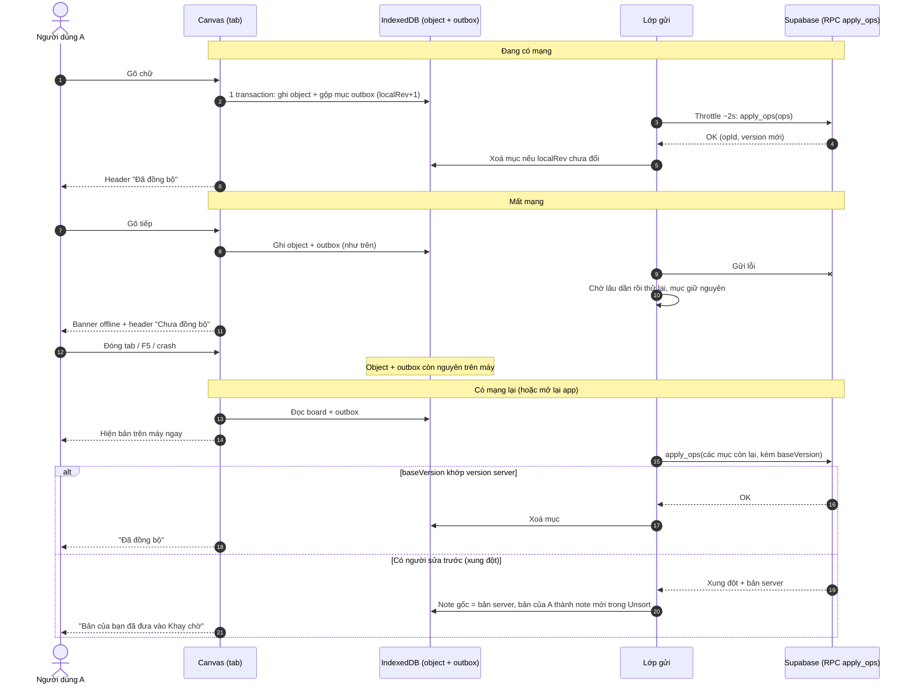
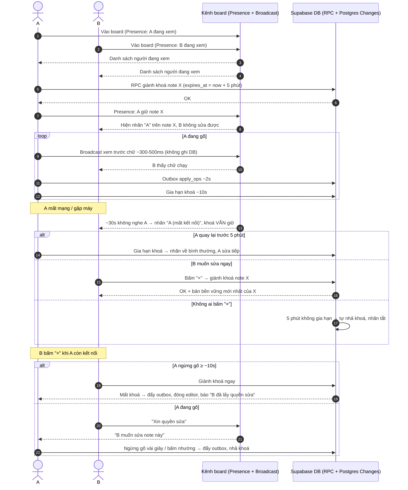

# Kiến trúc lưu + đồng bộ: Milanote đo được và hướng cho bibo

**Trạng thái**: Tham khảo (nguồn chuẩn cho mọi thứ đã đo trên Milanote về lưu / đồng bộ)
**Đo**: 2026-10-08 (2 tài khoản thật) và 2026-10-09 (Chrome DevTools MCP, board test "New Board")
**Dùng khi**: viết spec `canvas-sync` / `canvas-sharing`, chọn backend. ĐỌC FILE NÀY TRƯỚC, không đo lại bằng MCP trừ khi cần trả lời câu nằm ở mục "Chưa đo".

---

## Phần 1 — Milanote làm thế nào (đã đo)

### 1.1 Nguồn chuẩn

- Server là nguồn chuẩn. Mở board là lấy từ server.
- Bằng chứng: tab tài khoản 2 (ngữ cảnh tách riêng, không chung IndexedDB / localStorage) reload thấy ngay chữ tab 1 vừa gõ.

### 1.2 Đường truyền: WebSocket (socket.io), không dùng fetch / XHR cho nội dung

2 kết nối, mở cả khi chỉ 1 người dùng:

| Socket | URL | Chở gì |
|---|---|---|
| Chính | `wss://app.milanote.com/socket.io/?userId={user}&EIO=4&transport=websocket` | Thao tác: `ELEMENT_UPDATE`, `ELEMENTS_SELECTED`, ... |
| Theo board | `wss://app.milanote.com/collab/socket.io/?channel={boardId}&userId={user}...` | Con trỏ người cùng xem: `CURSOR_UPDATE` (x, y, status show/hide, cursorType) |

- Socket chính gắn theo tài khoản (URL không có board) → đồng bộ nhiều tab / nhiều máy của cùng 1 người.
- Socket collab gắn theo board = "phòng" của board.
- Gói ping `"3"` định kỳ (heartbeat socket.io).
- Không thấy `fetch`, XHR, `sendBeacon` nào chở chữ note. Chỉ XHR tới New Relic (telemetry).

### 1.3 Hình dạng gói ghi

```
42["action", {
  type: "ELEMENT_UPDATE",
  updates: [{ id: "<elementId>", changes: { textContent: <ProseMirror JSON CẢ note> } }],
  boardId, elementTypes: { "<elementId>": "CARD" },
  user: { _id, clientId, clientTick },   // clientTick tăng dần mỗi gói
  deviceId: "mdid-...", sessionId: "msid-...",
  channels: ["<boardId>"]                 // ELEMENTS_SELECTED dùng "<boardId>-LIVE"
}]
```

- Gửi CẢ nội dung note mỗi lần, không gửi phần vừa đổi (không OT / CRDT).
- `changes` là theo từng trường (`textContent`, ...) → đổi vị trí / màu thì gửi trường đó, không gửi cả object (kiểu Figma, theo thuộc tính).
- `clientId` + `clientTick` → server biết thứ tự gói của từng client, bỏ trùng.
- Paragraph trong ProseMirror JSON có `attrs.key` ngẫu nhiên (VD `"ueIi8"`) để giữ danh tính từng đoạn.
- Chọn note → gửi `ELEMENTS_SELECTED { ids, timestamp }` → server biết ai đang giữ note (dùng cho khoá).

### 1.4 Khi nào gửi

| Lúc | Gửi? |
|---|---|
| Đang gõ | Không gửi từng phím |
| Ngừng gõ ~3s (vẫn đang sửa) | Gửi. Đo 2026-10-08 thấy ~5s; 1 lần đo 8s chưa thấy gửi → khoảng chờ không cố định, chưa rõ quy tắc |
| Esc / thoát sửa | Gửi ngay |
| Reload / đóng tab | Gửi ngay, gói đi TRƯỚC `beforeunload` 2ms → đẩy gấp ở `beforeunload` qua socket đang mở |
| Header | Có chữ "Saved" |

### 1.5 Lưu trên máy

- `IndexedDB keyval-store` → key `redux` (idb-keyval, cùng thư viện bibo dùng): bản chụp CẢ Redux state, có `version` app + `timestamp`.
  - Có `state.elements` (nội dung note board đang mở, ProseMirror JSON), `users`, `permissions`, `app`, `local.boardEditors.editorTimestamps`, `lastSaved`, `localCache.hydration { hydrated, cacheTimestamp, cacheVersion }`.
  - Ghi định kỳ ~20s, không ghi mỗi phím.
- `IndexedDB workbox-expiration`: sổ hết hạn của service worker. File js / css / ảnh nằm ở Cache Storage (`static-js`, `static-css`, `user-images`).
  - (bạn xem 2026-10-12) Store `cache-entries`, mỗi dòng `{ id: "{cacheName}|{url}", url, cacheName, timestamp }`. `cacheName` và `timestamp` là 2 chỉ mục (để lọc theo cache và tìm mục cũ nhất để xoá), không phải dữ liệu con. Không chứa nội dung file.
  - Cache cả file của bên thứ 3 (Amplitude, New Relic, cookielaw, reCAPTCHA), file app (`manifest-*.js`, `main-*.js`, `vendor-*.js`), ảnh của user ở nhiều cỡ (`w=400/800/1600/display`).
  - Không thấy cache nào chứa trang HTML → khả năng cao đây là lý do reload offline không mở được app (mục 1.6). Suy luận, chưa kiểm Cache Storage.
- `IndexedDB AMP_diagnostics_*`: analytics Amplitude.
- localStorage: analytics, phiên đăng nhập (`betterAuthSessionUser { _id, rootBoardId, sessionExpiresAt }`), theme, `gridSize`, `returnState` (scroll + zoom theo từng board ≈ `camera` của bibo). KHÔNG có bản nháp note.
- sessionStorage: analytics.
- Telemetry Milanote tự báo: `supportsPersistenceLayer: true`, `clientLocalCache: false`, `clientPersistenceEnabled: false` → có lớp lưu trên máy đầy đủ nhưng đang tắt cho tài khoản này.

### 1.6 Mất mạng (giả lập Offline)

1. Vẫn gõ được. Header VẪN ghi "Saved" → báo sai.
2. WebSocket không gửi được gì. Không thấy hàng chờ gửi riêng (không key nào tên queue / pending / outbox).
3. ~20s sau, bản chụp `redux` ghi xuống IndexedDB có chữ mới.
4. Reload khi vẫn offline → `ERR_INTERNET_DISCONNECTED`, app KHÔNG mở được (service worker không phục vụ trang offline).
5. Có mạng, mở lại board → chữ gõ lúc offline còn, tài khoản khác thấy → app nạp bản chụp rồi đẩy phần lệch lên server. Chưa rõ cách so lệch.
- Suy ra: gõ offline rồi đóng tab trước lần chụp kế (≤ ~20s) → mất chữ.

### 1.7 Nhiều người / nhiều tab

- Khoá theo người chọn: A đang chọn / sửa note thì B không vào sửa được. B thấy nhãn tên A nhấp nháy trên note (`ElementUserTag active pulse`).
- Nhãn có nút "×" (`force-deselect-element`): B bấm để đẩy A ra, chữ A chưa lưu được ghi ngay. A bỏ chọn xong B sửa được.
- Cấu trúc DOM nhãn (bạn chép 2026-10-09):
  ```
  .ElementTag.ElementUserTag.active.pulse.animate-name
    .tag-contents
      .UserAvatar.active.has-image (--avatar-size: 24px)  → ảnh avatar 24px
      .name-container > .name                              → tên ("Bao")
      .force-deselect-element > svg.close-x-small (9x9)    → nút "×" trắng
  ```
  Nhãn nhấp nháy (`pulse`) khi người đó đang hoạt động. Ai xem board cũng bấm "×" được, bất cứ lúc nào.
- 2 tab / 2 thiết bị cùng 1 tài khoản: CÓ khoá như người khác (bạn thử lại 2026-10-09). Tab A đang sửa thì tab B / máy khác cùng tài khoản không sửa được. Ghi chú 2026-10-08 "không khoá" là sai.
- Không bao giờ có 2 người cùng gõ 1 note → không cần ghép chữ.

---

## Phần 2 — bibo làm theo, và làm tốt hơn ở đâu

### 2.1 Giữ giống Milanote

- Server là nguồn chuẩn. Mở board lấy từ server.
- Kênh realtime theo board (con trỏ, khoá, người đang xem, xem trước chữ). Khác Milanote: ghi bền vững qua RPC HTTP, không qua WebSocket (mục 2.8).
- Gói ghi theo trường (`changes`). (SỬA 2026-10-13 theo code: bibo bỏ trùng chỉ bằng `opId` đổi mỗi lần gộp, không dùng số thứ tự; `clientId` có trong request nhưng server chưa dùng. Nguồn chuẩn: `docs/system/21-server-sync.md`.)
- Note: gửi cả nội dung (HTML / ProseMirror JSON), không OT / CRDT ở giai đoạn 1.
- Thoát sửa / rời trang → đẩy gấp ngay.
- Khoá note theo người chọn, nhãn tên + nút "×" giành quyền.
- Cache Storage + service worker cho file tĩnh, ảnh.

### 2.2 Làm tốt hơn

| Chỗ Milanote yếu | bibo làm |
|---|---|
| Gõ chỉ được chụp xuống máy ~20s/lần → offline đóng tab là mất chữ | Ghi IndexedDB ngay mỗi lần gõ (hàng đợi kiểu Google Docs, đã có: `lib/write-queue.ts`) |
| Không có hàng chờ gửi riêng, chụp cả state | Outbox trong IndexedDB: chỉ phần chưa gửi, mỗi mục có mã riêng, gửi lại khi có mạng, chờ lâu dần khi lỗi |
| Header "Saved" khi đang offline | Phân biệt 3 trạng thái: "Đã lưu trên máy" / "Đã đồng bộ" / "Chưa đồng bộ (mất mạng)" |
| Offline không mở được app | Service worker phục vụ cả trang app + dữ liệu board đã có trên máy → mở được, sửa được (ĐÃ LÀM 2026-10-12, spec `app-offline`) |
| Khoảng chờ gửi khi đang gõ không cố định (3-8s), gõ liên tục thì không gửi | Tách 2 tầng (chốt 2026-10-09): IndexedDB ghi ngay (rẻ, trên máy). Server: outbox gom cửa sổ 1s có trần (gửi muộn nhất 1s sau thay đổi đầu, gõ liên tục vẫn gửi mỗi ~1s, không chờ ngừng gõ), gửi theo trường, + đẩy ngay khi thoát sửa / ẩn tab / rời trang. Không gửi mỗi phím → server nhẹ. (SỬA 2026-10-13: 1s thay throttle ~2s, áp cho cả chữ lẫn thuộc tính; đã code ở dev, spec `canvas-outbox`) |
| (Đã sửa 2026-10-09: Milanote CÓ khoá giữa tab / thiết bị cùng tài khoản, không phải chỗ yếu) | Giữ khoá giữa tab (Web Locks + BroadcastChannel, đã có). Tab / thiết bị khác cùng tài khoản xử y như người khác: cùng nhãn, cùng "×", cùng 2 mốc 30s / 5 phút (chốt 2026-10-09, mục 2.4a) |
| Xung đột khi sửa offline: chưa rõ, có thể đè | Không đè: bản thua thành note "bản xung đột" đưa vào Unsort của board (mục 2.6). So bằng `version` (đã có trường) |
| Khoá có thể treo khi tab đơ / mất mạng | Khoá có hạn: tab giữ khoá báo "còn giữ" định kỳ, hết hạn tự nhả |

### 2.3 Lộ trình từ code hiện tại

Code hiện có (spec `canvas-note-autosave`, đã xong):
- `api.ts` `withWriteQueue`: mọi ghi object qua hàng đợi, IndexedDB đang là nguồn chuẩn.
- `lib/write-queue.ts`: 1 lô đang ghi, gom chờ, đẩy gấp (`flush({ urgent })`), kênh `text` / `props`.
- `types.ts`: trường `version`.
- `hooks/useCanvasPersistence.ts`: đẩy gấp khi `pagehide` / ẩn tab.
- `lib/tab-channel.ts` + `lib/edit-locks.ts`: đồng bộ + khoá giữa tab.
- (2026-10-13, chỉ dev) `sync/`: outbox gửi theo trường, lớp gửi cửa sổ 1s, server giả `dev/fake-api/`. Chi tiết `.kiro/specs/canvas-outbox/design.md`.

Khi có backend (trạng thái 2026-10-13 ghi trong ngoặc):
1. (XONG, `canvas-storage-v2`) Gộp 2 database idb-keyval thành 1 database `bibo-canvas` nhiều store, để outbox ghi CÙNG transaction với object.
2. (XONG ở dev, `canvas-outbox`) Store `outbox` (phiên bản 3). Hàng đợi ghi IndexedDB như cũ, cùng transaction ghi mục outbox. Lớp gửi đọc outbox → server giả `/__fake-api/apply` → xác nhận → xoá mục. `canvas-sync` thay server giả bằng RPC `apply_ops`.
3. (CHƯA, `canvas-sync`) IndexedDB đổi vai: từ nguồn chuẩn thành bản trên máy. Mở board: hiện bản máy ngay, rồi nhận bản server, gộp theo `version`.
4. (XONG ở dev, `canvas-outbox` Task 7) Gói gửi theo trường: create / patch / delete. Trường = `geometry`, từng khoá `data`, `type`, `boardId`, `unsortIndex`. Kênh `text` / `props` chỉ còn là nhãn.
5. (XONG ở dev) Đẩy gấp lúc rời trang: `fetch(..., { keepalive: true })`. Chỉ là cố gắng, an toàn nằm ở outbox.
6. BroadcastChannel giữa tab giữ lại (rẻ hơn đi vòng qua server), khoá giữa người dùng làm qua phòng board.
7. Giai đoạn 2 (chỉ khi cần gõ chung 1 note): thay riêng kênh `text` bằng Yjs, phần còn lại giữ nguyên.

### 2.4a Nhãn người đang sửa + giành quyền (bạn chốt hướng 2026-10-09: học Milanote + khoá có hạn)

Giữ của Milanote: nhãn avatar 24px + tên + nhấp nháy khi đang hoạt động + nút "×" giành quyền. Chữ người bị đẩy ra được gửi trước khi người giành vào sửa.

Cải tiến (Milanote cho ai cũng "×" bất cứ lúc nào → dễ đẩy người đang gõ dở). Đề xuất, chốt chi tiết khi viết `canvas-sharing`:
- Khoá có hạn, 2 mốc (CHỐT 2026-10-09):
  - Tab giữ khoá báo "còn giữ" mỗi ~10s.
  - ~30s không nghe → coi là KHÔNG CÒN HOẠT ĐỘNG: nhãn đổi thành "{tên} (mất kết nối)". Khoá VẪN giữ, rớt wifi ngắn không mất note. B thấy rõ để bấm "×" an toàn.
  - ~5 phút không nghe → tự nhả khoá, nhãn biến mất. Chỉ để dọn khoá bị bỏ rơi (gập máy, không ai bấm "×").
  - A quay lại trước 5 phút → báo "còn giữ" lại, nhãn về bình thường, sửa tiếp.
  - "×" vẫn là đường chính để B giành quyền, không phải chờ 5 phút.
- "×" theo tình trạng người giữ:
  - Người giữ đã ngừng gõ ≥ ~10s (hoặc mất kết nối): "×" giành ngay.
  - Người giữ đang gõ: "×" thành "Xin quyền sửa". Người giữ thấy báo "{tên} muốn sửa note này", tự nhường sau khi ngừng gõ vài giây, hoặc bấm nhường ngay.
  - Chủ board: luôn giành ngay được.
- Người bị giành: thấy báo "{tên} đã lấy quyền sửa note này", editor đóng, chữ đã gửi đủ.

### 2.4b Kết quả bàn (2026-10-09, đã đóng phiên bàn)

- Ghi máy ngay: CHỐT theo 3 nhóm lưu (mục 2.5) — nội dung ghi IndexedDB ngay từng object, UI state chụp gộp. Thêm cảnh báo khi rời trang nếu còn thay đổi chưa đồng bộ (ý của bạn). Lý do không chờ 20s: crash / hệ điều hành tắt tab không có sự kiện rời trang; ghi IndexedDB lúc rời trang không chắc xong; 20s của Milanote là hệ quả của chụp cả state.
  - Vì sao Milanote chụp cả state: bản trên máy của họ chỉ là cache (server là nguồn chuẩn, mất cache không sao), dùng 1 bộ lưu chung kiểu redux-persist cho mọi thứ, mở app chỉ đọc 1 key. Rẻ để làm, đủ cho cache.
  - Bibo lưu từng object vì bản trên máy phải giữ thay đổi chưa gửi (outbox), board lớn, ghi 1 phần, lỗi 1 object không hỏng cả bản. UI state (camera, panel) có thể chụp gộp.
- Outbox: ĐÃ CHỐT làm (2026-10-09).
- Gửi server: ĐÃ CHỐT, xem mục 2.7 (3 luồng: máy / bền vững gom 1s / xem trước realtime; 2s cũ đổi thành 1s ngày 2026-10-13).
- Xung đột: ĐÃ CHỐT, bản của mình vào Unsort (mục 2.6). Tự gộp để nâng cấp sau.
- CÒN MỞ, bàn khi viết `canvas-sharing`:
  - (ĐÃ CHỐT 2026-10-09) Offline + board đang chia sẻ: 30s → nhãn "mất kết nối", khoá giữ; B bấm "×" nếu muốn; 5 phút → tự nhả (mục 2.4a).
  - (ĐÃ CHỐT 2026-10-09) Khoá giữa tab / thiết bị cùng tài khoản: xử y như 2 người khác nhau (giống Milanote). Cùng nhãn avatar + tên, cùng "×", cùng 2 mốc 30s / 5 phút. Mỗi tab là 1 người giữ khoá riêng (khoá gắn theo phiên tab, không theo tài khoản).
  - Giao diện bản xung đột trong Unsort, trường hợp note gốc / board gốc đã bị xoá.

### 2.5 Ba nhóm lưu trên máy (chốt 2026-10-09)

| Nhóm | Lưu | Cách |
|---|---|---|
| A. Nội dung board | IndexedDB, từng object | id ổn định, `version`. Sửa note chỉ ghi record đó |
| B. Outbox | IndexedDB, cùng database với A | Ghi CÙNG transaction với object. Xoá mục chỉ khi server xác nhận |
| C. UI state | Chụp gộp, có thể debounce | Camera, zoom, panel. Không chứa dữ liệu chưa đồng bộ |

Quy tắc outbox (cập nhật 2026-10-13 theo code `canvas-outbox`, file `src/tools/canvas/sync/`):
- Mục outbox = `{ objectId, kind, isNew, fields, channels, baseVersion, rev, opId, groupId, createdAt }`, mỗi object tối đa 1 mục. Payload đọc từ object store lúc gửi (cùng transaction nên luôn khớp), không chép nội dung 2 lần.
- Trường đổi tính lúc ghi: so bản mới với bản cũ đọc trong cùng transaction (`object-fields.ts`). Trường = `geometry` (cả khối), từng khoá `data`, `type`, `boardId`, `unsortIndex`.
- Gộp theo object, hợp các trường: gõ 100 phím vẫn chỉ 1 mục với `fields = ['data.body']`. `baseVersion` giữ version lúc bắt đầu sửa (dùng phát hiện xung đột).
- Gói gửi: `create` (server chưa có: nguyên object) / `patch` (`set` trường đã đổi + `unset` khoá data đã xoá) / `delete` (chỉ id). `null` là giá trị, không phải "xoá khoá".
- `opId` đổi mỗi lần gộp (thay `localRev` cũ): server bỏ gói trùng theo `opId`; client chỉ xoá mục có `opId` khớp → sửa tiếp trong lúc gửi không bị xoá nhầm.
- Patch tới object server không có → server trả `missingObjectIds`, client chuyển mục sang `create`.
- Thao tác nhiều object (dán, nhân bản, xoá board có con, kéo nhiều object) ghi cùng 1 lô hàng đợi → chung `groupId`, nằm chung 1 request. Server giả kiểm dạng cả request trước khi áp (sai 1 mục → không áp gì); patch thiếu object bị bỏ riêng lẻ. RPC thật ở `canvas-sync` phải áp cả nhóm hoặc không gì.
- Tiền đề: 1 database (đã xong, `canvas-storage-v2`).

### 2.6 Xung đột (chốt 2026-10-09)

Giai đoạn 1 — bản phục hồi vào Unsort (bạn đề xuất, Kiro duyệt 2026-10-09; giao diện bàn sau):
- Server giữ bản đến trước (B) làm bản chính trên canvas.
- Bản của A thành 1 note mới, đưa vào Unsort (Khay chờ) của đúng board chứa note gốc. Không chiếm chỗ trên canvas, không mất chữ.
- A thấy thông báo: "Note X đã được sửa ở nơi khác. Bản của bạn đã đưa vào Khay chờ." (có nút mở Khay chờ).
- Note phục hồi cần: dấu "Bản xung đột" + tham chiếu tới note gốc (để sau này có nút "so với bản gốc" / "thay bản gốc").
- Chỉ tạo khi thật sự xung đột (`baseVersion` của A khác version server). Không xung đột thì lên thẳng.
- Trường hợp biên cần chốt khi viết spec: B đã XOÁ note gốc → bản của A khôi phục lại chỗ cũ trên canvas hay vẫn vào Unsort; board chứa note bị xoá → đưa vào Unsort board cha gần nhất còn tồn tại.

Nâng cấp sau (ghi để nhớ) — tự gộp:
- Gộp các thay đổi không chồng nhau, chỉ hỏi khi 2 người sửa cùng phần.
- Đơn vị gộp hợp lý: từng đoạn (paragraph). Milanote gắn `attrs.key` ngẫu nhiên cho mỗi paragraph → gộp theo đoạn được. ĐÃ LÀM 2026-10-13 (spec `canvas-note-block-keys`): mỗi khối cấp ngoài cùng có `data-key` 8 ký tự qua `@tiptap/extension-unique-id`, note cũ được cấp lúc mở sửa. Chưa gửi theo đoạn: `data.body` vẫn là 1 trường khi gửi patch.
- Khó: rich text lồng nhau, list, checklist, ảnh. Gộp mức ký tự thì dùng Yjs (giai đoạn 2), không tự viết.

### 2.7 Nhịp gửi + realtime (ĐÃ CHỐT 2026-10-09, sửa 2026-10-13: luồng 2 dùng 1 cửa sổ 1s cho cả chữ lẫn thuộc tính)

3 luồng tách nhau, khác nhịp (luồng 2 qua RPC HTTP, luồng 3 qua kênh realtime WebSocket của Supabase, xem 2.8):
1. Lưu trên máy: IndexedDB ngay mỗi thay đổi + outbox (bảo vệ bản nháp).
2. Đồng bộ bền vững (server ghi DB): gom cửa sổ 1s có trần, CỐ ĐỊNH, không đổi theo người xem. Đã code ở dev (`canvas-outbox`).
3. Xem trước realtime (server chỉ chuyển tiếp, KHÔNG ghi DB): chỉ khi có người khác đang xem board, ~300-500ms. Mất gói không sao.

| Dữ liệu | Lưu trên máy | Gửi server | Nhịp |
|---|---|---|---|
| Nội dung note đang gõ (bền vững) | IndexedDB ngay (hàng đợi, đã có) | Outbox, patch `data.body` | Cửa sổ 1s (muộn nhất 1s sau thay đổi đầu), lần gửi cuối tự có khi hết cửa sổ |
| Nội dung note đang gõ (xem trước) | Không | Kênh phòng board | ~300-500ms, chỉ khi có người xem. Người xem hiện bản xem trước; khi người gõ nhả khoá thì nạp lại bản bền vững từ server |
| Vị trí / kích thước / màu sau khi thả, tạo, xoá | IndexedDB ngay | Outbox, patch trường đã đổi (tạo: create, xoá: delete) | Cùng cửa sổ 1s (SỬA 2026-10-13, trước là "gửi ngay": kéo lẻ từng item ra 1 request mỗi lần) |
| Thoát sửa, ẩn tab, rời trang, đổi board | — | Đẩy gấp phần còn chờ | Ngay, không chờ hết cửa sổ (rời trang: keepalive) |
| Con trỏ, vị trí lúc ĐANG kéo | Không lưu | Kênh phòng board (tạm thời) | Throttle ~50-100ms, bỏ gói cũ nếu chưa kịp gửi |
| Chọn / khoá / nhả khoá / "còn giữ" | Không lưu | Kênh phòng board | Chọn, khoá, nhả: ngay. "Còn giữ": ~10s. 30s im → "mất kết nối". 5 phút im → tự nhả |

Quy tắc:
- Không debounce chờ ngừng gõ. Cửa sổ có trần: thay đổi đầu mở cửa sổ 1s, hết cửa sổ thì gửi mọi mục đang chờ (mọi object) trong 1 request. Thay đổi mới không gia hạn cửa sổ.
- Mỗi lúc 1 request bay; lỗi thì giữ mục, thử lại sau 1s, 2s, 4s… tối đa 30s.
- Dữ liệu tạm thời KHÔNG qua outbox, mất cũng không sao (gói sau thay gói trước).
- Gõ liên tục 1 phút: ~60 request ghi DB + ~120-200 gói xem trước chỉ chuyển tiếp (chỉ khi có người xem). Đo dev 2026-10-13: gõ 10s → 10 request.
- Không cần trailing riêng: thay đổi cuối luôn nằm trong 1 cửa sổ đã mở, hết cửa sổ là gửi.
- Xác nhận theo mã gửi: mỗi lần gộp đổi `opId`. Server trả `opId` đã nhận; client chỉ xoá mục có `opId` khớp. Có sửa mới trong lúc gửi thì `opId` đã khác → mục giữ lại, chờ lượt sau (thay `localRev` cũ, cùng mục đích).
- Chỉ 1 tab gửi (Web Lock `bibo-canvas-outbox`), tab khác báo qua BroadcastChannel.
- Không trông vào `beforeunload` / `pagehide`: đẩy gấp chỉ là cố gắng, an toàn thật nằm ở outbox.
- Debounce vs throttle KHÔNG khác nhau về giữ bản nháp trên máy (cả 2 đều có IndexedDB). Khác ở: server tụt sau bao lâu, và người xem thấy chữ lúc nào. Bản nháp chỉ mất nếu máy hỏng / xoá dữ liệu trình duyệt trước khi đồng bộ.
- Các số (1s, 300-500ms, 50-100ms, 10s) là mặc định ban đầu, chỉnh theo đo thực tế khi có backend.

### 2.8 Backend: Supabase (bạn chọn 2026-10-09, chưa ghi vào `bibo-foundation`)

Ánh xạ 3 luồng (mục 2.7) sang Supabase:

| Luồng | Supabase |
|---|---|
| Con trỏ, vị trí lúc kéo, bản xem trước chữ | Realtime **Broadcast**, mỗi board 1 kênh, không ghi DB |
| Ai đang xem board, nhãn ai đang giữ note | Realtime **Presence** (mất kết nối tự biến mất) |
| Nhận thay đổi người khác đã lưu | Realtime **Postgres Changes** |
| Ghi bền vững (outbox) | HTTP gọi RPC theo lô `apply_ops(ops[])`, dạng gói create / patch / delete ở `src/tools/canvas/sync/protocol.ts`: kiểm `baseVersion`, bỏ `opId` trùng, áp theo trường, áp cả nhóm hoặc không gì, trả `acceptedOpIds` + `missingObjectIds`. Không ghi qua WebSocket như Milanote; nhịp 1s nên HTTP đủ |
| Rời trang | `fetch(..., { keepalive: true })` gọi RPC. Chỉ là cố gắng, an toàn nằm ở outbox |

Lưu ý:
- Supabase CÓ WebSocket (Realtime: Broadcast, Presence, Postgres Changes đều chạy trên 1 kết nối WebSocket). Nhưng kết nối đó chỉ chuyển tiếp / phát sự kiện, không ghi DB. Ghi DB (insert, update, `rpc()`) của supabase-js luôn đi HTTP qua PostgREST. Nên "ghi bền vững qua HTTP" là cách Supabase vận hành, không phải bibo tự chọn bớt.
- Presence KHÔNG đủ để chốt khoá (2 người bấm cùng lúc không quyết được ai thắng). Khoá thật = 1 dòng DB có `expires_at`, giành / gia hạn / nhả bằng RPC. Presence chỉ để hiện nhãn.
- Kiểm giới hạn Realtime theo gói giá (số kết nối, số tin / giây) khi viết spec: xem trước chữ + con trỏ gửi dày.
- Kiro nói theo hiểu biết, chưa đối chiếu tài liệu Supabase mới nhất. Kiểm lại khi viết spec.
- Donor `bibo-hub` đã dùng Supabase (auth, edge function proxy): đọc tham khảo cách tổ chức, không chép nguyên.

Cần có trước khi làm phần server: project Supabase, auth (đăng nhập), schema bảng board / object / khoá, sửa spec `bibo-foundation` thêm Supabase vào stack.

ĐÃ CHỐT 2026-10-13 (bạn chọn):
- `bibo-foundation` đã ghi Supabase + `bibo-auth` vào stack, chỉ ghi, chưa cài thư viện. Khung client + biến môi trường làm ở Task 1 `canvas-sync`.
- Auth: chờ `bibo-auth`. Thứ tự đổi thành `bibo-foundation` → `bibo-auth` → `canvas-sync` → `canvas-sharing`.
- SỬA 2026-10-13 (bạn chốt, thay 2 dòng trên và dòng "Phase 1 `bibo-auth`" bên dưới): đăng nhập nằm ngay trong app canvas (Supabase Auth), không có service SSO riêng. Sản phẩm chỉ có landing + app. Thứ tự: đăng nhập trong app → `canvas-sync` → `canvas-sharing`.
- SỬA 2026-10-13 (bạn chọn, thay thứ tự dòng trên): làm outbox + server giả trong máy TRƯỚC đăng nhập, để test cơ chế gom request sớm (spec `canvas-outbox`). Thứ tự: `canvas-outbox` → đăng nhập trong app → nối Supabase thật (`canvas-sync`) → `canvas-sharing`. Đánh đổi: lúc nối Supabase phải gắn thêm người dùng / token vào lớp gửi.
- Project dữ liệu: tạo MỚI. Bạn dùng nhiều project Supabase để tăng dung lượng. Các project tin token của project auth nhờ nhập chung 1 khoá ký JWT (`docs/supabase-setup.md`).
- ĐÃ CHỐT 2026-10-13: chia project theo hướng A (board ở 1 project chính, chỉ file chia nhiều project), chuẩn bị sẵn cho hướng C (gán mỗi người vào 1 project). `canvas-sync` bắt buộc: cột chủ sở hữu mọi dòng, bảng "board → project" từ đầu, client lấy kết nối theo board. Chi tiết `docs/supabase-setup.md` mục "Chia nhiều project".
- ĐÃ CHỐT 2026-10-13: project auth = project MỚI (không dùng project auth của donor). Phase 1 `bibo-auth` chỉ cần đăng nhập + `/authorize` + `/token` + làm mới + đăng xuất chạy thật, cộng kiểm token chéo (spec `bibo-auth` Phase 7). Nối bibo vào `bibo-auth` (callback, giữ token) làm trong `canvas-sync`.
- ĐÃ CHỐT 2026-10-13: job định kỳ gọi `SELECT` thật qua REST tới từng project để chống tạm dừng (gọi health không đủ). ĐỂ SAU (chốt 2026-10-13): nghiêng pg_cron → Edge Function → `SELECT` REST mỗi ngày, xem `docs/supabase-setup.md` mục "Giới hạn phải biết trước". Không để `service_role_key` trên trình duyệt.

### 2.9 Hiệu năng (đánh giá 2026-10-09, chưa đo trên trình duyệt)

Rẻ, không lo: hàng đợi ghi (gom lô, 1 transaction), khoá giữa tab (hỏi 3s/lần khi tab hiện), BroadcastChannel (chỉ gửi id), outbox (gộp theo object + trường).

Rủi ro thật trong code hiện tại (đọc code thấy, chưa đo):
1. ĐÃ SỬA (kiểm code 2026-10-13): `ObjectsLayer` chỉ theo dõi danh sách id (`useShallow`), `ObjectView` memo tự đọc theo id → gõ 1 note không render lại card khác. Còn lại chi phí O(N) mỗi lần store đổi (mỗi phím): clone Map trong `updateData`, `canvasObjectIds` lọc + sắp xếp cả board, N selector `objects.get(id)`. Nhỏ ở board vài trăm object, tăng theo N.
2. Mở board quét cả database: `loadObjects` đọc mọi key mọi board rồi `get` tuần tự. Sửa: store có chỉ mục `boardId` (gộp database, mục 2.3 bước 1). Bản nhanh: `entries()` 1 lần.
3. `getHTML()` mỗi phím: tốn theo độ dài note. Sửa nếu cần: chỉ gọi khi hàng đợi sắp ghi.
4. Chưa làm: service worker (cache sai làm tải lần đầu chậm), gộp bản máy với bản server lúc mở board (board lớn phải làm theo lô).

Ngân sách đề xuất (đo bằng DevTools trên board giả lập 500 note):
- Gõ: mỗi phím phản hồi < 50ms, không rớt khung hình.
- Kéo object: 60fps.
- Mở board 500 object: < 500ms.
- Ghi IndexedDB: vài lô / giây khi gõ hoặc kéo liên tục.

Kế hoạch đo (2026-10-13): dùng bảng dev (`src/dev/`, spec `dev-panel`), chế độ Phiên, 5 kịch bản:
A kéo 1 item lặp ~10 lần, B kéo ~20 item cùng lúc, C gõ ~200 ký tự thường, D gõ nhanh, E gõ trên board ~300 object.
Mỗi phiên cho: số đưa vào (text / props), số lô, object / lô, % gom, thời gian ghi, long task, và mô phỏng gom 300ms / 1s / 2s.
Quyết theo số: ghi máy < ~5ms / lô và không long task → không gom ở lớp máy; long task khi gõ → sửa render (mục 1) trước;
cửa sổ gom cho lớp gửi Supabase chọn ở `canvas-sync` theo bảng mô phỏng.

Số đo (Chrome, Windows, board 5 object):
- A kéo lẻ, 51s: 52 lần đưa vào (toàn props), 52 lô, 1 object / lô, gom 0%. Ghi tb 11ms, max 19ms. Long task 0.
  Mô phỏng: 300ms=48, 1s=22, 2s=13. 1 cú kéo item không ở trên cùng = 2 lần ghi cùng object
  (`bringToFront` lúc bắt đầu kéo + `commitMove` lúc thả, `useObjectDrag.ts`).
- B kéo nhiều item, 7.4s, board 19 object: 247 đưa vào, 26 lô, tb 9.5 / max 18 object mỗi lô → transaction giảm ~89%
  (gộp khác id), gộp cùng id 0%. Ghi tb 16ms, max 25ms. Long task 0. Mô phỏng: 300ms=12, 1s=4, 2s=3.
  Max 18 khi chọn 19: vòng ghi đồng bộ của `commitMove` bị tách 1 + N-1 lô vì đưa vào đầu tiên kick ghi ngay (đọc code).
- C gõ thường, 25s: 133 đưa vào (132 text, 1 props), 116 lô, 1 object / lô → transaction giảm 13%. Ghi tb 7ms, max 29ms.
  Long task 0 (board 6 object, chưa thấy chi phí render). Mô phỏng: 300ms=42, 1s=17, 2s=9.
- D gõ nhanh, 11.6s: 435 text, 204 lô → transaction giảm 53%. Ghi tb 6.9ms, max 19ms. Long task 0.
  Mô phỏng: 300ms=18, 1s=7, 2s=4. Hàng đợi tự giới hạn tốc độ ghi khi gõ nhanh.
- E lần 1, 10.7s, board 1856 object: ĐO LẪN. 897 props (1 lô 895 object, có vẻ là 1 thao tác hàng loạt như duplicate / paste
  trong lúc đo) + chỉ 46 text. Ghi tb 46ms, max 521ms (lô 895). Long task 3, max 454ms — chưa tách được do render 1856
  object, do clone 895 object lúc `put`, hay do gõ. Cần đo lại E: bấm Bắt đầu sau khi board đứng yên, chỉ gõ. Bảng dev bản đầu ghi "gom được" = chỉ gộp cùng id, đọc dễ hiểu sai; đã tách 2 dòng
  "transaction giảm" + "gộp cùng id" (2026-10-13).

Kết luận lớp máy (ĐÃ CHỐT 2026-10-13): ghi IndexedDB đủ rẻ, KHÔNG đo thêm, KHÔNG thêm debounce ở lớp máy. Đo E lại không cần.

Yêu cầu cho outbox gửi Supabase (ghi 2026-10-13, làm ở `canvas-sync`, CHƯA test được vì chưa có outbox):
- Vấn đề cần tránh: 1 thao tác = 1 request (kéo 1 item gửi 1 request, mỗi phím gõ gửi 1 request). Mỗi request tốn 1 chuyến mạng
  + kiểm quyền + RLS, nặng hơn ghi máy nhiều lần.
- Cái cần đo là SỐ REQUEST gửi đi, không phải thời gian ghi IndexedDB.
- Hướng: outbox gom theo cửa sổ thời gian có trần (gửi muộn nhất W ms sau thay đổi đầu, không chờ ngừng gõ). Gom mọi object
  thay đổi trong cửa sổ vào 1 request. Cùng object chỉ gửi bản mới nhất. Gửi ngay (bỏ cửa sổ) khi ẩn / đóng tab.
- Số tham khảo từ mô phỏng (đếm lần thay đổi, chưa phải request thật): kéo lẻ 52 lần trong 51s → gom 1s còn 22, 2s còn 13;
  gõ nhanh 204 lần trong 11.6s → 300ms còn 18, 1s còn 7. ĐÃ CHỐT 2026-10-13: W = 1s cố định.
- ĐÃ CHỐT 2026-10-13 (spec `canvas-outbox`): server giả = đường dẫn `/__fake-api/` trong `npm run dev` (request thật, mất khi
  tắt dev); chỉ chiều gửi đi, chiều nhận về để `canvas-sync`. ĐÃ CHỐT (bạn duyệt spec 2026-10-13): 1 cửa sổ 1s cho CẢ
  chữ lẫn thuộc tính, thay dòng "Vị trí / kích thước / màu ... gửi ngay" và "throttle ~2s" ở bảng mục 2.7. Đã code xong.
- 2026-10-13: bản đầu `canvas-outbox` gửi NGUYÊN object (lệch mục 2.1 / 2.5). Đã sửa sang gửi theo trường như đã chốt:
  create / patch (`set` + `unset`) / delete, trường = `geometry` + từng khoá `data` + `type` / `boardId` / `unsortIndex`.
  Mục outbox có `fields` + `isNew` (thay cho `localRev`, dùng `rev` + `opId`). Đo: note ~8KB chỉ kéo → 410B / request.
  RPC `apply_ops` của `canvas-sync` nhận đúng dạng gói này (`src/tools/canvas/sync/protocol.ts`).
- Lúc làm `canvas-sync`: thêm mục "Outbox" vào bảng dev (số request, object / request, thời gian request, lỗi, thử lại,
  đang chờ) + server giả trong máy (chỉnh độ trễ, tỉ lệ lỗi, offline) để test gom trước khi nối Supabase thật.
- Phải test: gộp giữ đúng bản mới nhất; sửa chữ + kéo cùng lúc không mất phần nào; lỗi thì giữ lại + thử lại; offline / đóng
  tab giữa chừng thì lần mở sau gửi tiếp; không gửi trùng.
- Giảm request tận gốc (làm được trước outbox): 1 cú kéo đang ghi 2 lần (`bringToFront` lúc bắt đầu + `commitMove` lúc thả);
  thả nhiều item tách 2 lô (lô đầu 1 object). Sửa 2 chỗ này thì outbox cũng nhận ít thay đổi hơn.

### 2.10 Thứ tự làm (đề xuất 2026-10-09)

1. Bạn test Task 1-5 của `canvas-note-autosave` trên trình duyệt (test case A/B/C/D trong chat 2026-10-09; nếu mất chat: xem verify từng task trong `tasks.md` của spec đó).
2. Spec ngắn (VD `canvas-storage-v2`), không cần backend: gộp 2 database idb-keyval thành 1 có chỉ mục `boardId` (kèm chuyển dữ liệu cũ) + sửa rủi ro hiệu năng 1. Đo theo ngân sách 2.9.
3. Sửa `bibo-foundation`: thêm Supabase vào stack.
4. Spec `canvas-sync`: outbox, RPC `apply_ops`, header 3 trạng thái, cảnh báo rời trang, xung đột vào Unsort, id cố định cho từng đoạn Tiptap.
5. Spec `canvas-sharing`: mời board, khoá DB có hạn, Presence nhãn tên, Broadcast con trỏ + xem trước chữ. Bàn 3 điểm còn mở ở 2.4b.
6. Service worker mở app khi offline (thêm thư viện → sửa `bibo-foundation`). ĐÃ LÀM 2026-10-12 (spec `app-offline`, làm TRƯỚC bước 3 theo bạn chốt). Bước 2 cũng đã xong (`canvas-storage-v2`). Việc kế: bước 3.

### 2.11 Câu cần chốt khi viết spec

- Gộp database IndexedDB: dùng IndexedDB thuần hay thư viện `idb` (cùng tác giả idb-keyval, hỗ trợ nhiều store); bước chuyển dữ liệu từ 2 database cũ.
- (ĐÃ CHỐT + ĐÃ LÀM 2026-10-12) Service worker phục vụ trang offline: `vite-plugin-pwa` 2.0.0 (Workbox), đã ghi vào `bibo-foundation`.
- (ĐÃ CHỐT 2026-10-12, `canvas-storage-v2`) Gộp database: IndexedDB thuần tự bọc (`lib/idb.ts`), không chuyển dữ liệu cũ.
- (ĐÃ TRA 2026-10-13) Giới hạn Realtime Supabase theo gói giá, xem 2.11a.

### 2.11a Giới hạn Supabase theo gói (tra 2026-10-13)

Nguồn: [Realtime Limits](https://supabase.com/docs/guides/realtime/limits), [Realtime Pricing](https://supabase.com/docs/guides/realtime/pricing), [Pricing & Fees](https://supabase.com/docs/pricing/). Số liệu tóm lại, không chép nguyên văn.

| | Free | Pro ($25/tháng) |
|---|---|---|
| Kết nối realtime cùng lúc | 200 | 500 (vượt: $10 / 1.000) |
| Tin / giây (toàn project) | 100 | 500 |
| Tin / tháng | 2 triệu | 5 triệu (vượt: $2,50 / 1 triệu) |
| Vào kênh / giây | 100 | 500 |
| Kênh / kết nối | 100 | 100 |
| Tin Presence / giây | 20 | 50 |
| Gọi Presence / client / 30s | 5 | 5 |
| Cỡ gói Broadcast | 256 KB | 3.000 KB |
| Cỡ gói Postgres Changes | 1.024 KB | 1.024 KB |
| Khác | Tạm dừng sau 1 tuần không hoạt động, tối đa 2 project đang chạy | Không tạm dừng |

Vượt "tin / giây" thì server cắt kết nối, supabase-js tự nối lại khi lưu lượng giảm. 1 tin = 1 gói gửi đi HOẶC 1 gói giao tới 1 client (gửi 1 tin tới 3 người xem = tính 4).

Ước lượng với nhịp ở 2.7 (Kiro tính, chưa đo):
- Con trỏ 50-100ms = 10-20 tin / giây / người, nhân theo số người xem. 2 người cùng board, cả 2 di chuột: ~40-80 tin / giây → sát trần 100 của Free.
- 2 triệu tin / tháng của Free ≈ 28 giờ có 2 người cùng board liên tục ở 20 tin / giây.
- Kết luận: Free đủ cho giai đoạn 1 (1 người dùng, không chia sẻ: không gửi xem trước / con trỏ). Khi làm `canvas-sharing` phải: con trỏ ≥ 100ms và chỉ gửi khi có người khác đang xem, xem trước chữ 500ms, "còn giữ" khoá đi qua DB (RPC) chứ không qua Presence (Presence chỉ 5 lần / 30s / client).
- Presence 5 lần / 30s / client: chỉ cập nhật Presence khi đổi trạng thái (vào board, giữ / nhả note), không dùng cho nhịp 10s.
- Free tạm dừng sau 1 tuần không hoạt động, lần gọi đầu chậm 10-30s (nguồn dev.to, không phải tài liệu chính thức). Outbox chịu được (gửi lại), nhưng mở board lần đầu sẽ chậm.

---

### 2.12 Sơ đồ (vẽ 2026-10-09, theo các mục 2.5-2.8)

Bản HTML tương tác (mở bằng trình duyệt, có tab "góc nhìn", sáng / tối, xuất PNG): `docs/sync-diagrams/1-offline-recovery.html`, `2-outbox-lifecycle.html`, `3-shared-board.html`. Nguồn JSON cùng thư mục, sửa JSON rồi render lại bằng skill `kiro-technical-diagrams`. Bản Mermaid dưới đây là bản đọc nhanh trong markdown.

Hai điểm sơ đồ thêm, CHƯA bàn trong chat (duyệt khi viết `canvas-sync`):
- Nhánh "bị từ chối" (mất quyền, object / board đã xoá): không thử lại, giữ chữ trong Unsort.
- Chỉ 1 tab gửi outbox (giữ Web Lock `bibo-sync-sender`), tab khác không gửi trùng.

#### (1) Mất mạng rồi khôi phục



#### (2) Vòng đời 1 mục outbox

```mermaid
stateDiagram-v2
  [*] --> ChoGui: Sửa object (cùng transaction ghi object)
  ChoGui --> ChoGui: Sửa tiếp cùng object + trường → gộp, localRev+1
  ChoGui --> DangGui: Tới lượt throttle / đẩy gấp
  DangGui --> Xong: Server OK, localRev không đổi trong lúc gửi
  DangGui --> ChoGui: Server OK nhưng có sửa mới trong lúc gửi → giữ lại lượt sau
  DangGui --> ChoGui: Lỗi mạng / timeout → chờ lâu dần rồi thử lại
  DangGui --> ChoGui: Tab đóng giữa chừng → mở lại gửi lại (server bỏ trùng theo opId)
  DangGui --> XungDot: baseVersion lệch version server
  XungDot --> Xong: Bản server thắng, bản mình → note mới trong Unsort
  DangGui --> BiTuChoi: Server từ chối hẳn (mất quyền, object/board đã xoá)
  BiTuChoi --> Xong: Báo người dùng; note còn chữ → đưa vào Unsort board cha gần nhất
  Xong --> [*]: Xoá mục khỏi outbox
```

Khôi phục theo từng kiểu lỗi:

| Kiểu | Khôi phục |
|---|---|
| Mất mạng, timeout | Giữ mục, thử lại chờ lâu dần, có mạng lại thì gửi ngay |
| Tab đóng / crash lúc đang gửi | Mở lại gửi lại cùng `opId`, server bỏ bản trùng |
| Sửa mới trong lúc gửi | Server xác nhận `localRev` cũ, mục giữ lại với `localRev` mới |
| Xung đột (`baseVersion` lệch) | Bản server thắng, bản mình vào Unsort (mục 2.6) |
| Bị từ chối (mất quyền, object đã xoá) | Không thử lại. Báo người dùng, giữ chữ trong Unsort |
| Thao tác nhiều object | Cả nhóm 1 lần: server áp hết hoặc không gì, nhóm cùng trạng thái |

#### (3) Nhiều người cùng 1 board



Sơ đồ (3) áp y nguyên cho 2 tab / 2 thiết bị cùng tài khoản (A và B là 2 phiên tab). A mất kết nối mà còn chữ chưa gửi, B giành khoá → chữ của A lên sau qua outbox → xung đột → vào Khay chờ của A (mục 2.6), không mất.

### 2.13 Double check hướng giải quyết (2026-10-09)

Đã kiểm: mục 2.1-2.12 không còn mâu thuẫn (đã sửa 2.1, 2.3 bước 2 và 5 từ "WebSocket" sang RPC theo 2.8).

Chỗ thiếu, phải xử khi viết `canvas-sync` (chưa có trong các mục trên):
1. **`version` đổi chủ.** Hiện `api.ts` tự đóng dấu `version` trên máy. Khi có server, `version` phải do server cấp (máy chỉ giữ `baseVersion` + `localRev`). Không thì 2 máy cùng đóng số 6 → không phát hiện được xung đột.
2. **Hết phiên đăng nhập lúc offline.** Có mạng lại, RPC trả 401 → phải làm mới token rồi gửi tiếp, KHÔNG được coi là "bị từ chối" (sẽ đẩy nhầm chữ vào Unsort).
3. **Một tab gửi.** Nhiều tab cùng đọc outbox sẽ gửi trùng (server bỏ trùng theo `opId` nhưng tốn lượt). Dùng Web Lock giữ quyền gửi, tab giữ đóng thì tab khác tự nhận.
4. **Xoá ↔ sửa offline.** A sửa note offline, B xoá note. Server trả "đã xoá" → nhánh bị từ chối → chữ A vào Unsort. Khớp mục 2.6, cần ghi rõ trong spec.
5. **Thuộc tính không phải chữ** (vị trí, màu, kích thước): bản đến sau thắng theo từng trường, không tạo bản xung đột. Chấp nhận vì dễ nhìn thấy và sửa lại. Ghi rõ để khỏi bàn lại.
6. **Đổi cấu trúc outbox giữa 2 bản app.** Mục outbox cần `schemaVersion`; mở app bản mới mà outbox bản cũ còn mục thì phải chuyển hoặc gửi bằng định dạng cũ, không xoá.
7. **Đồng hồ máy.** Không dùng giờ máy để so cũ / mới. Chỉ so `version` server + `localRev`.

Đánh giá chung: hướng đã chốt (ghi máy ngay + outbox cùng transaction + RPC theo lô + khoá DB có hạn + xung đột vào Unsort) đủ để không mất chữ trong mọi nhánh đã vẽ. Rủi ro còn lại nằm ở 7 điểm trên, đều là chi tiết spec, không đổi hướng.

## Chưa đo (chỉ đo lại MCP nếu cần trả lời đúng câu này)

- Quy tắc chính xác khoảng chờ gửi khi đang gõ (3s / 5s / 8s không đều).
- Cách Milanote so lệch bản chụp `redux` với server khi mở lại sau offline.
- Milanote xử lý xung đột ra sao khi 2 nơi cùng sửa offline.
- Socket collab có mở khi board không chia sẻ hay không.
